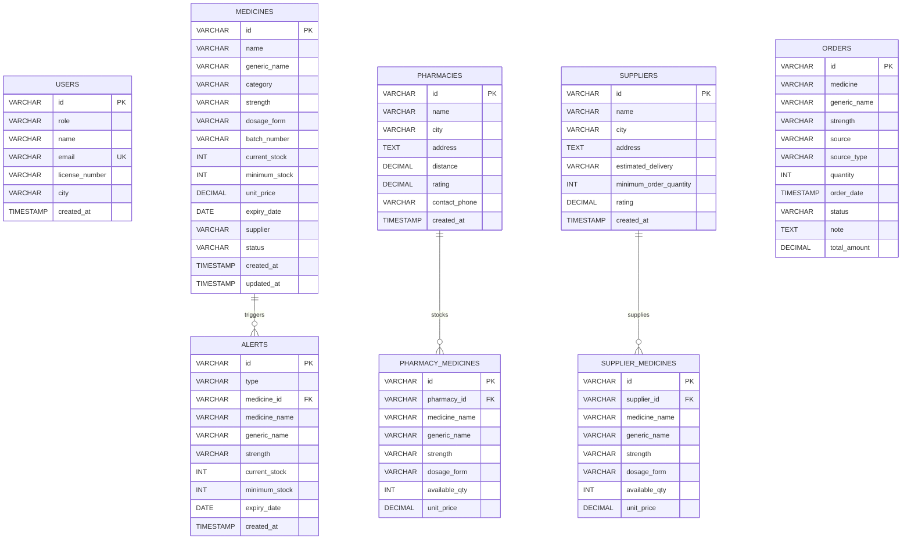

# 🗄️ Pharma Inventory — Database Layer

This directory contains the database design, schemas, seed records, and documentation for the **Pharma Inventory System**.

---

## 📂 Directory Contents

| File | Purpose |
|------|---------|
| [`schema.sql`](./schema.sql) | Table definitions, primary/foreign key constraints, indices, and checks. |
| [`seeds.sql`](./seeds.sql) | Initial mock data for medicines, pharmacies, suppliers, orders, and alerts. |

---

## 🏗️ Entity Relationship Diagram



---

## 🚀 How to Run / Import the Database

### Option 1: SQLite (Instant, Zero Configuration)
```bash
sqlite3 pharma.db < schema.sql
sqlite3 pharma.db < seeds.sql
```

### Option 2: PostgreSQL
```bash
psql -U postgres -d pharma_inventory -f schema.sql
psql -U postgres -d pharma_inventory -f seeds.sql
```

### Option 3: MySQL / MariaDB
```bash
mysql -u root -p pharma_inventory < schema.sql
mysql -u root -p pharma_inventory < seeds.sql
```
